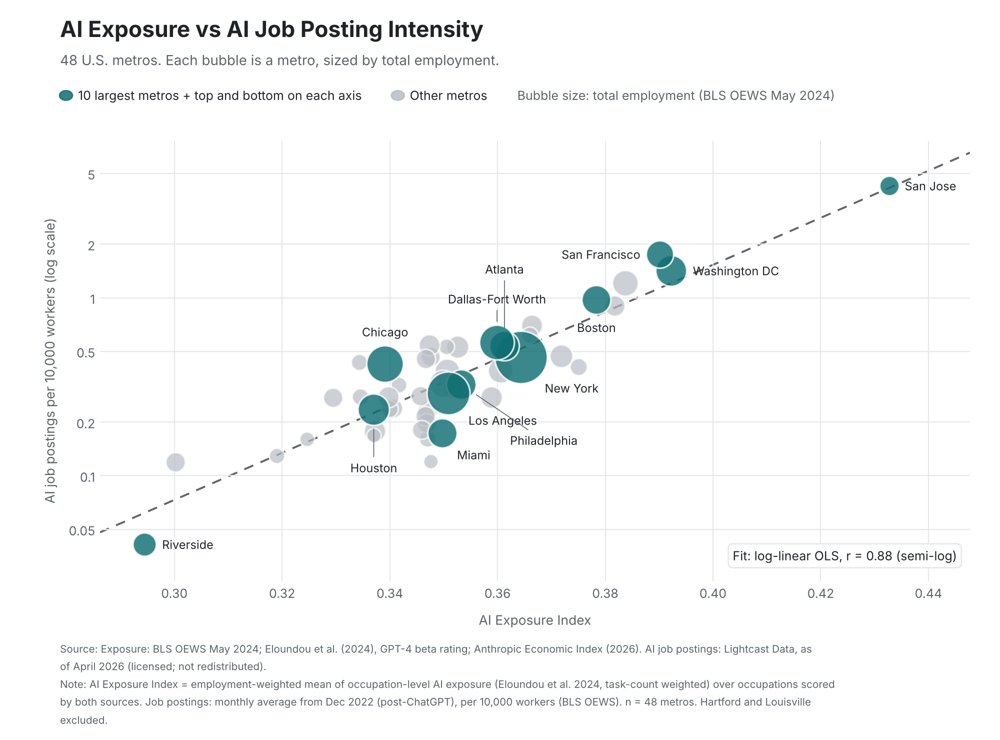
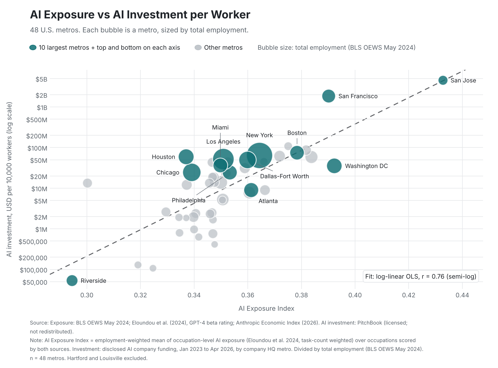
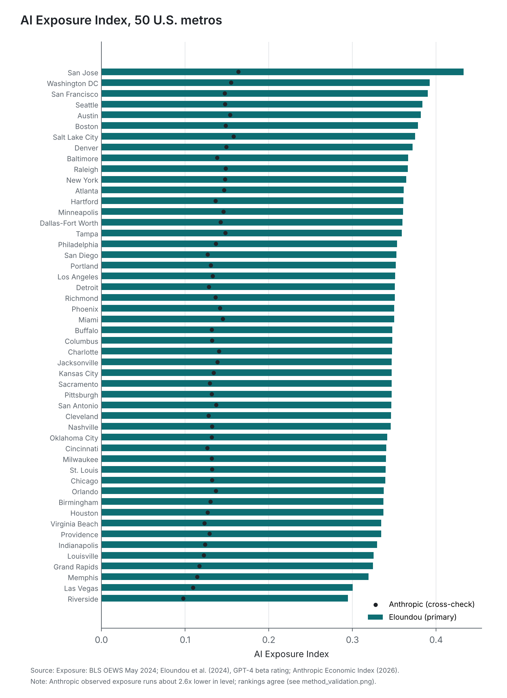
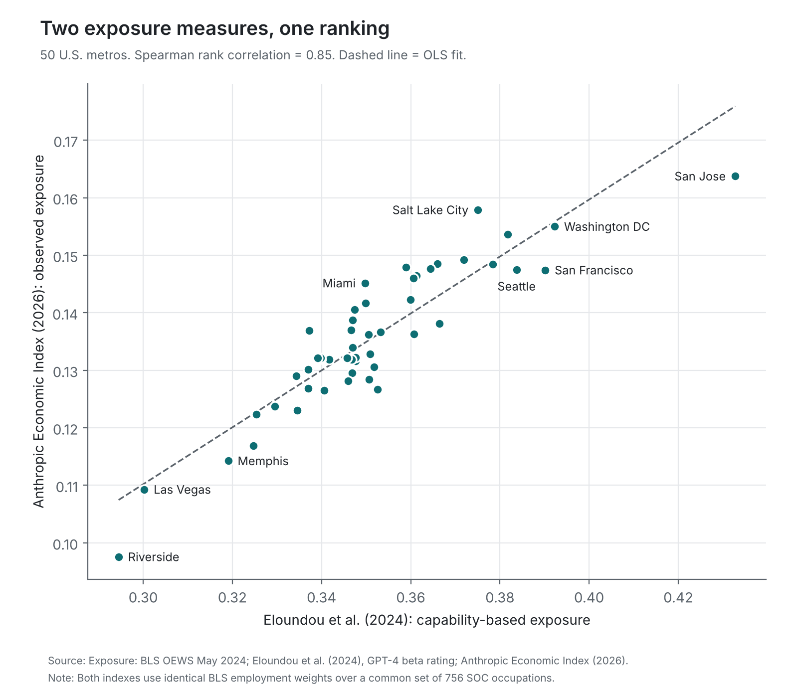

# AI Exposure Index for U.S. Metros

An open, reproducible index of how exposed each U.S. metro's workforce is to generative AI, built entirely from public data. It is the x-axis behind the exposure-versus-opportunity charts developed as part of the MIT Real Estate Action Lab × JLL project and cited in JLL Research's [Where AI is changing jobs and what it means for real estate](https://www.jll.com/en-us/insights/artificial-intelligence-and-its-implications-for-real-estate) (September 2026).







## What is open and what is not

| Layer | Status |
|---|---|
| **Code** | All of it, including the y-axis loaders and plotting code (MIT License). |
| **Exposure data (x-axis)** | Open. Built from BLS OEWS, Eloundou et al. (2024) and the Anthropic Economic Index. Processed tables are in `data/processed/`. |
| **Opportunity data (y-axis)** | Not included. AI job postings (Lightcast) and AI investment (PitchBook) are licensed. Bring your own extract (see `data/private/README.md`). `data/sample/` holds **synthetic** files with the same schema so the pipeline runs end to end. |
| **Figures** | `figures/` holds the two exposure-versus-opportunity charts as static images, and exposure-only figures. The underlying y-axis values are not distributed. |

## Method

1. **Occupation scores (6-digit SOC 2018).**
   *Primary:* Eloundou et al. (2024), GPT-4 rated β exposure (`dv_rating_beta`, β = E1 + 0.5·E2). O*NET-SOC codes are averaged to 6-digit SOC.
   *Cross-validation:* Anthropic Economic Index observed exposure (`observed_exposure`), based on actual Claude usage.
2. **Common occupation set.** Only the 756 SOC codes scored by both sources are kept, so both metro indexes use identical employment weights and are directly comparable. Using all Eloundou-scored occupations instead raises metro values by about 0.004 on average and leaves the 50-metro ranking unchanged.
3. **Metro index.** Employment-weighted mean of occupation scores, with weights from BLS OEWS May 2024 detailed-occupation employment in each MSA. Suppressed BLS cells are dropped. Median employment coverage across the 50 study metros is about 90%.

**Why cross-validate.** Eloundou scores what a GPT-4-class model *could* do with each task, rated in 2023. That is the standard measure in the literature, but it is theoretical and model-rated. The Anthropic Economic Index measures what people *actually* use Claude for in 2026. If metro rankings hold under both, the index reflects real occupational structure rather than one rating method. Anthropic is not the primary measure because it reflects one product's user base, which skews toward software tasks.

**Validation.** Across the 50 study metros the two measures agree on ranking (Spearman 0.85, Pearson 0.91). Eloundou runs about 2.6 times higher in level: it measures what models *can* do, Anthropic measures what users *actually* do.



### Known limitations

- Eloundou exposure is weighted by task **count**, not task **hours**.
- Metro scores reflect occupation mix only. Two metros with the same mix score the same, regardless of firm-level adoption.
- "Exposure" means a share of tasks AI could affect. It is not a forecast of job losses or rent changes.
- The Anthropic dataset is updated over time. `src/ai_exposure/sources.py` pins the version used here by checksum.

## Study universe

`config/study_msas.csv` lists the 50 metros. The exposure-versus-opportunity charts use **48**: Hartford and Louisville are excluded (`in_d3_sample = 0`). Use `--sample all50` to include them.

## Reproduce

```bash
pip install -r requirements.txt
make data      # download public inputs, verify checksums
make index     # build data/processed/*
make figures   # exposure-only figures
```

BLS may block scripted downloads. If so, download [oesm24ma.zip](https://www.bls.gov/oes/special-requests/oesm24ma.zip) in a browser and put `MSA_M2024_dl.xlsx` in `data/raw/`.

### With your own licensed y-axis data

```bash
# data/private/ai_postings.csv    msa_code, ai_postings_per_10k
# data/private/ai_investment.csv  msa_code, ai_investment_usd
make private   # writes output/private/*.png (gitignored)
# No licensed data? Test the pipeline with the synthetic sample:
# PYTHONPATH=src python -m ai_exposure.plot --metric postings --input data/sample/SYNTHETIC_ai_postings.csv
make video     # 12-second MP4 animations for social posts (gitignored)
make check     # confirms no licensed value is in the publishable files
```

Investment is plotted per 10,000 workers (total disclosed AI funding divided by BLS total employment) so both charts share the same per-worker basis. Job postings start in December 2022 (post-ChatGPT); investment covers January 2023 to April 2026. Statistics computed on public substitutes will differ from those in the original study and should be reported separately.

## Adapting to other countries or regions

The method only needs employment by region and occupation. Everything else is reused.

```bash
# 1. If your data uses another occupation system, convert it to SOC 2018
python -m ai_exposure.crosswalk --employment region_occ_employment.csv \
    --crosswalk occ_to_soc.csv --out region_soc_employment.csv

# 2. Build the index for your regions
python -m ai_exposure.regional --employment region_soc_employment.csv --out data/processed/<country>
```

(Run with `PYTHONPATH=src`, after `make data`.) Input formats are documented at the top of `src/ai_exposure/crosswalk.py` and `src/ai_exposure/regional.py`. Running the U.S. data through this path reproduces the published metro values exactly.

**Example: Canadian CMAs**

1. **Employment.** Statistics Canada Census 2021 employment by occupation (NOC 2021) for each census metropolitan area (CMA).
2. **Crosswalk.** Chain Statistics Canada's NOC 2021 to NOC 2016 v1.3 concordance with its [NOC 2016 v1.3 to U.S. SOC 2018 concordance](https://www.statcan.gc.ca/en/statistical-programs/document/reference-note/noc2016v1_3-soc2018US). Many links are many-to-many. By default `crosswalk.py` splits each NOC code's employment across its SOC codes in proportion to U.S. national employment; use `--split equal` or a `weight` column to override.
3. **Check coverage.** The script reports how much employment had no crosswalk match. Coverage in `region_exposure.csv` shows the share of employment that received a score.

Resulting CMA values are on the same 0 to 1 scale as the U.S. metros and can be compared directly, with the caveat that crosswalk choices add some measurement error.

### Why other AI risk indexes do not line up with this one

This index is a **share of work tasks** (0 to 1) exposed to LLMs, weighted by **occupation** employment. Indexes published as percentile scores (for example 0 to 10) or weighted by **industry** mix measure something different, so rescaling them will not reproduce these values. For a like-for-like comparison, apply the same occupation scores and employment weighting as above.

## Outputs

| File | Contents |
|---|---|
| `data/processed/occupation_exposure.csv` | 756 SOC occupations, both scores |
| `data/processed/msa_exposure_all.csv` | All 393 BLS metro areas |
| `data/processed/msa_exposure_study.csv` | 50 study metros with ranks |
| `data/processed/validation.json` | Agreement statistics |

## Data sources and licenses

| Source | About | Download | License | Use here |
|---|---|---|---|---|
| U.S. BLS, Occupational Employment and Wage Statistics, May 2024 | [OEWS tables](https://www.bls.gov/oes/tables.htm) | [oesm24ma.zip](https://www.bls.gov/oes/special-requests/oesm24ma.zip) (MSA file) | Public domain | Employment weights |
| Eloundou, Manning, Mishkin & Rock (2024), *GPTs are GPTs: Labor market impact potential of LLMs*, Science 384(6702) | [Paper](https://doi.org/10.1126/science.adj0998) | [occ_level.csv](https://github.com/openai/GPTs-are-GPTs/blob/main/data/occ_level.csv) | MIT | Primary exposure score |
| Anthropic Economic Index (2026) | [Dataset page](https://huggingface.co/datasets/Anthropic/EconomicIndex) | [job_exposure.csv](https://huggingface.co/datasets/Anthropic/EconomicIndex/blob/main/labor_market_impacts/job_exposure.csv) | CC BY | Cross-validation score |
| Lightcast AI job postings | | Proprietary, **not included** | | Figure 1 y-axis |
| PitchBook AI deal data | | Proprietary, **not included** | | Figure 2 y-axis |

The exact file versions are pinned by SHA-256 checksum in `src/ai_exposure/sources.py`; `make data` verifies them. Processed tables that include Anthropic scores are shared under CC BY with attribution to the Anthropic Economic Index.

## Citation

> Bao, Rey (2026). AI Exposure Index for U.S. Metros. Developed as part of the MIT Real Estate Action Lab × JLL project. https://github.com/reybao/ai-exposure-index

## Disclaimer

- **Research use only.** This repository is for research and educational purposes. Nothing here is investment, legal, or financial advice.
- **No affiliation or endorsement.** The views expressed are the author's own. They do not represent the official position of, and are not endorsed by, MIT, JLL, Lightcast, PitchBook, Anthropic, or OpenAI.
- **Provided as is.** Data and code are provided without warranty of accuracy or completeness. Third-party data remain subject to their original licenses and terms.
- **Exposure is not a forecast.** The index measures the share of occupational tasks that AI could affect. It does not predict changes in employment, rents, or asset values.

## License

Code: MIT (see `LICENSE`). Data: see the sources table above.
